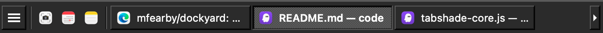
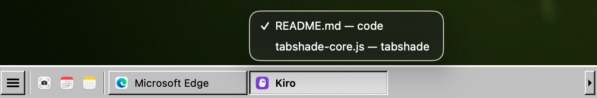
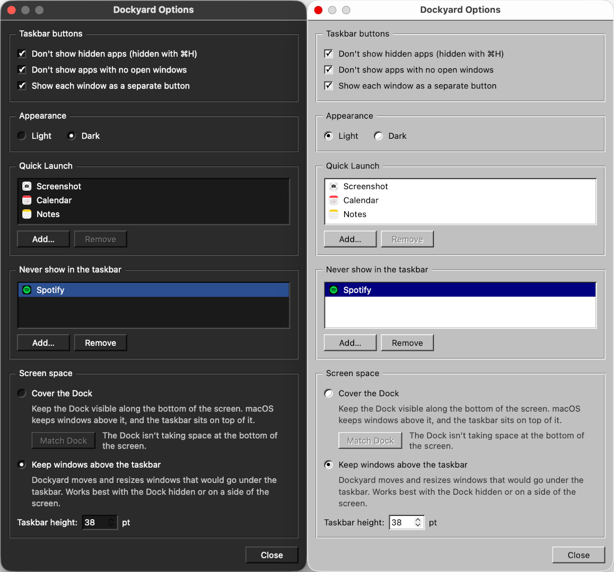

# Dockyard

Dockyard is a Windows 95-style taskbar for macOS. It runs along the bottom of your main display and gives
every running app (or every window) its own button with an icon and a text label, as an alternative to the Dock.

## Screenshots

The taskbar in the dark theme:

<p>
  
</p>

The taskbar in the light theme with 'Show each window as a separate button' turned off:

<p>
  
</p>

The Options window, in the dark theme (left) and the light theme (right):

<p>
  
</p>

## Built with Kiro

Dockyard was built with [Kiro](https://kiro.dev), an AI coding assistant. If you have Kiro, you can build
Dockyard without following the steps below: open this folder in Kiro and type `/build-dockyard` in the chat
(or ask Kiro to "build Dockyard"). That runs the project's
[build-dockyard skill](.kiro/skills/build-dockyard/SKILL.md), which checks your Mac's requirements, installs
the Command Line Tools if they're missing, sets up the signing certificate, builds the app, runs the tests and
opens it.

## Features

- A button for each running app, or optionally for each window, labelled with the window's title. With windows
  grouped, clicking an app's button when it's already in front lists its windows to choose from (if there are two or more).
- Drag buttons to reorder them. The order is remembered.
- Badges on buttons, copied from the apps' Dock icons (such as unread mail counts).
- An hourglass and a dimmed label on the button of an app that's still starting up.
- Right-click a button to minimise, maximise or close its window, or quit the app.
- A Quick Launch area of app icons next to the menu button.
- A menu button with Downloads, Bin and Finder, as on the Dock.
- Options to leave out hidden apps, apps with no open windows, or apps you choose.
- Two ways to share the screen with other windows: cover the Dock, or move and resize windows so they stay
  above the taskbar.
- Light and dark themes, an adjustable height, and a toggle that retracts the taskbar.

Settings are saved in `~/.config/dockyard/config.json`.

## Building it yourself

### Requirements

- macOS 14 (Sonoma) or later.
- Apple's Command Line Tools, for the Swift compiler. Full Xcode isn't needed. Install them with:

  ```bash
  xcode-select --install
  ```

- [Node.js](https://nodejs.org) 22.18 or later, for building the web UI. For example, `brew install node`.

### Build and run

```bash
git clone https://github.com/mfearby/dockyard.git
cd dockyard
scripts/build-app.sh
open build/Dockyard.app
```

`build-app.sh` installs the web UI's dependencies the first time, builds the TypeScript UI and the Swift app,
and packages them as `build/Dockyard.app`. You can run the app from there, or copy it to `/Applications`.

To quit Dockyard, click the menu button (three lines) at the left of the taskbar and choose **Quit Dockyard**.

### Accessibility access

Several features need Accessibility access: separate window buttons, badges, the right-click window actions,
hiding apps with no windows, and keeping windows above the taskbar. Open **Options…** from the menu button and
press **Grant Access…**, or add Dockyard in **System Settings → Privacy & Security → Accessibility**.

### Keeping permissions across rebuilds (optional)

By default the app is signed with a temporary ("ad-hoc") signature that changes on every build, so macOS forgets
the Accessibility permission each time you rebuild. To avoid that, create a self-signed certificate once:

```bash
scripts/setup-dev-cert.sh
```

This adds a "Dockyard Local Dev" code-signing certificate to your login keychain, and `build-app.sh` uses it
from then on. It only works on your Mac and can't be used to distribute the app. Grant Accessibility access once
more after the first build signed with it. To remove the certificate, delete "Dockyard Local Dev" in Keychain
Access.

### Running the tests

```bash
scripts/test.sh
```

This runs the Swift tests (Swift Testing) and the TypeScript tests (Node's built-in test runner), and
type-checks the UI.

## Project layout

- `Sources/Dockyard` is the native app: the taskbar window, app and window tracking, and menus (Swift and AppKit).
- `Sources/DockyardCore` holds the logic that doesn't need AppKit, kept separate so it can be unit tested.
- `web` is the taskbar and Options UI (TypeScript, HTML and CSS), shown in a web view.
- `scripts` contains the build, test and signing scripts.

## Tip: hiding the Dock

macOS doesn't let apps remove the Dock. You can make it hide automatically and take longer to appear, so it
doesn't pop up by accident:

```bash
defaults write com.apple.dock autohide -bool true
defaults write com.apple.dock autohide-delay -float 1
killall Dock
```

To show it on demand, press **⌥⌘D**. To undo the delay, run
`defaults delete com.apple.dock autohide-delay && killall Dock`.

## Licence

Copyright © 2026 Marc Fearby.

Dockyard is free software: you can redistribute it and/or modify it under the terms of the GNU General Public
License as published by the Free Software Foundation, either version 3 of the License, or (at your option) any
later version. It is distributed in the hope that it will be useful, but without any warranty; without even the
implied warranty of merchantability or fitness for a particular purpose. See [LICENSE](LICENSE) for the full text.
